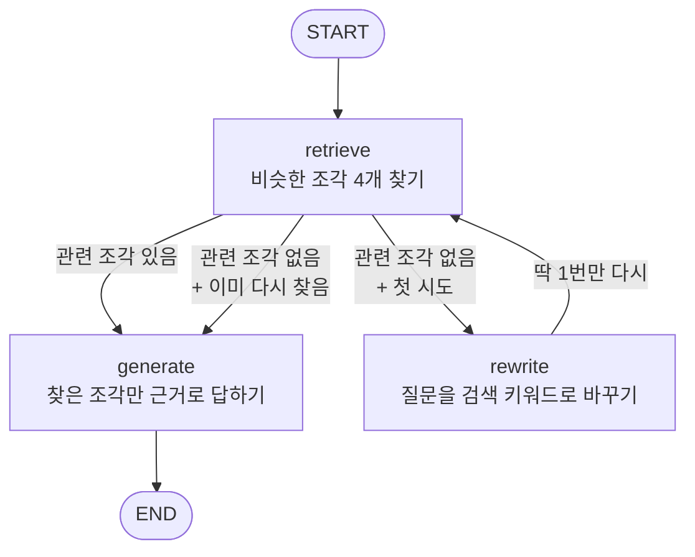

# 무역 공부 도우미

무역 용어와 내 수업 노트를 물어보면, `data/` 문서를 **근거로** 답해 주는 개인 챗봇 웹앱이에요.
답 아래에 출처(파일 이름 + 해당 내용 미리보기)를 보여 주고, 문서에 없으면 **"문서에서 찾지 못했어요"** 라고 답해요.

- 화면: Streamlit 채팅 (예시 질문, 글자가 흘러나오는 답, 진행 단계 표시) + 용어 카드 외우기 + 자료 추가
- 문서 찾기: RAG — 문서를 조각내 벡터로 저장하고, 질문과 비슷한 조각을 찾아 근거로 써요
- 부품: LangChain · 흐름: LangGraph · 벡터 저장소: Chroma (내 컴퓨터의 `chroma_db/`)

## 실행 방법
1. 가상환경을 만들고 설치해요 (Windows PowerShell).
   ```bash
   python -m venv .venv
   .venv\Scripts\pip install -r requirements.txt
   ```
2. `.env.example` 을 `.env` 로 복사하고 `OPENAI_API_KEY=` 뒤에 내 키를 넣어요. 키는 다른 사람에게 보여 주지 마세요.
3. 문서 넣기 (처음 한 번. 문서를 바꾼 뒤에도 다시 실행하면 바뀐 부분만 처리해요)
   ```bash
   .venv\Scripts\python ingest.py
   ```
4. 앱 실행
   ```bash
   .venv\Scripts\streamlit run app.py
   ```
   브라우저에서 http://localhost:8501 이 열려요. 3번을 건너뛰어도 첫 화면의 **자료 준비하기** 버튼으로 같은 일을 할 수 있어요.

## 사용한 모델
`.env` 에서 읽어요. 코드에는 모델 이름도 키도 없어요.

| 쓰임 | 환경 변수 | 기본값 |
|---|---|---|
| 답변 · 질문 바꾸기 | `OPENAI_MODEL` | `gpt-6-luna` |
| 임베딩 | `OPENAI_EMBED_MODEL` | `text-embedding-3-small` |
| (선택) 모델의 생각 시간 | `OPENAI_REASONING_EFFORT` | `low` — 답이 약 2배 빨라지고 토큰도 줄어요. 지원하지 않는 모델이면 `none` |

## 화면에서 할 수 있는 것
- **질문하기**: 입력창에 쓰거나 첫 화면의 예시 질문을 눌러요. "문서에서 관련 내용을 찾는 중" 같은 단계가 보이다가, 답이 글자 단위로 흘러나와요. 첫 화면에는 오늘의 용어도 나와요.
- **마스코트 "선하"**: 컨테이너를 닮은 선장 캐릭터예요. 이름은 선하증권(B/L)의 "선하(船荷, 배에 실은 짐)"에서 따왔어요. 평소엔 배 위에서 손을 흔들고 눈을 깜빡이고, 답을 찾는 동안엔 돋보기를 들고 갸웃거려요. 답을 찾았을 땐 카드 모서리에서 폴짝 뛰고, 문서에서 못 찾았을 땐 물음표를 띄우며 갸웃해요. SVG 도형과 CSS 움직임이라 사진이나 GIF 보다 가볍고 확대해도 선명해요. 컴퓨터 설정에서 "동작 줄이기"를 켜 두면 움직이지 않아요.
- **카드로 외우기**: 용어 노트의 `- 용어: 뜻` 줄을 카드로 만들어요. 용어를 보고 뜻을 떠올린 뒤 "뜻 보기" → "알았어요 / 헷갈려요"로 표시하고, 헷갈린 카드만 다시 볼 수 있어요. OpenAI 를 부르지 않아서 무료예요.
- **대화 저장**: 질문 · 답 · 출처를 `.md` 파일로 내려받아요.
- **출처 확인**: 답 아래 작은 회색 글씨로 파일 이름과 근거가 된 줄이 나와요.
- **못 찾았을 때**: "문서에서 찾지 못했어요" 와 함께 다음에 해 볼 일을 한 줄 알려 줘요. 이때 출처는 보이지 않아요.
- **이어 묻기**: 바로 앞 대화 2번까지 기억해서 "그건 뭐야?" 같은 질문의 대상을 이해해요. 근거는 그래도 문서에서만 찾아요.
- **자료 추가 · 삭제**: 사이드바의 "자료 추가하기"로 `.md` · `.txt` · `.pdf`(2MB까지)를 올릴 수 있어요. 추가한 자료만 지울 수 있고, 처음 3개 문서는 지워지지 않아요.
- **새 대화 시작**: 대화 기록을 비워요.

## 구조 (LangGraph 노드 흐름)


| 노드 | 하는 일 |
|---|---|
| `retrieve` | 검색 문장과 가까운 조각 4개를 찾고, 거리가 1.40 보다 먼 조각은 버려요 |
| `rewrite` | (도전) 관련 조각이 없을 때만 질문을 핵심 무역 용어로 바꿔요. 이전 대화도 참고해요. 최대 1번 |
| `generate` | 조각이 없으면 모델을 부르지 않고 "문서에서 찾지 못했어요". 있으면 그 조각만 근거로 답하고 출처를 붙여요 |

상태(state): `question`, `history`, `search_query`, `retries`, `docs`, `answer`, `sources`

지어내기를 줄이려고 세 겹으로 막았어요: ① 거리가 먼 조각은 아예 버리고(모델 호출 없이 "찾지 못했어요") ② 프롬프트에서 "조각에 그대로 적힌 내용만, 영어 풀네임 · 번역도 조각에 있을 때만" 이라고 못 박고 ③ 모델이 못 찾았다고 하면 출처를 숨겨요. 출처에는 가장 가까운 조각과 비슷하게 가까운 것만 보여요.

### 조각 나누기 (교안의 500자와 다르게 한 이유)
이 프로젝트의 노트는 `- 용어: 설명` 한 줄이 한 항목이고 문서도 200~500자로 짧아요. 500자로 자르면 노트 한 개가 통째로 한 조각이 돼서, 용어를 돌려 물으면 못 찾는 일이 있었어요(시험에서 확인). 그래서 **노트는 한 줄(항목)이 한 조각**, **PDF 같은 줄글은 500자 + 80자 겹침**으로 잘라요.

## 파일 구성
| 파일 | 역할 |
|---|---|
| `ingest.py` | `data/` 문서를 조각내 임베딩 후 `chroma_db/` 에 저장. 이미 저장된 조각은 다시 임베딩하지 않아요 |
| `graph.py` | LangGraph 흐름 (`python graph.py` 는 흐름 그림 출력, `python graph.py "질문"` 은 터미널 시험) |
| `app.py` | Streamlit 채팅 화면 |
| `.streamlit/config.toml` | `DESIGN.md` 의 색 (테마) |
| `data/` | 연습용 (가상) 문서 3개 |
| `조사노트.md` | LangChain · LangGraph 사용법 메모 (`CLAUDE.md` 에서 불러와요) |
| `CLAUDE.md` · `.claude/rules/` · `.claude/settings.json` | Claude Code 규칙. `settings.json` 은 `.env` 를 읽지 못하게 잠가요 |
| `DESIGN.md` | 색 · 글꼴 · 말풍선 규칙 |
| `제출_캡처/` | 제출용 화면 캡처 3장 (+ 보너스 2장) |
| `check_embed.py` | 임베딩이 뜻이 비슷한 문장을 잘 찾는지 보는 점검 스크립트 |

## 시험 결과
| 질문 | 결과 |
|---|---|
| FOB 와 CIF 는 뭐가 달라? | 문서대로 답하고 `02_무역용어_노트.md` 출처 표시 |
| 한빛무역의 주요 시장은 어디야? | "베트남, 태국, 스웨덴" + `01_가상_회사소개.md` 출처 |
| 스웨덴 수출 관세율이 몇 퍼센트야? | "문서에서 찾지 못했어요" (출처 없음) |
| 선사가 짐 받았다고 끊어 주는 종이가 뭐야? | 질문을 바꿔 다시 검색한 뒤 B/L(선하증권)로 답함 |
| FOB · B/L 의 영어 풀네임이 뭐야? | 문서에 영어 풀네임이 없어서 "문서에서 찾지 못했어요" (모델이 아는 지식을 보태지 않음) |
| (선하증권 다음) 그럼 그건 영어로 뭐라고 해? | 직전 대화를 참고해 문서에 있는 "B/L" 로만 답함 (세 번 시험, "Bill of Lading" 같은 지어낸 답 없음) |
| 자료 추가: `.txt` 올리고 "DDP 가 뭐야?" | 새 자료에서 찾아 답하고 출처에 파일 이름 표시. 지우면 검색에서도 사라짐 |

질문 19개 묶음 시험(문서에 있는 것 12 · 없는 것 7)에서 기대대로 답했고, 질문 한 번에 약 1~3초(질문 바꾸기가 끼면 3~4초)가 걸렸어요. (모델 생각 시간 `low` 로 줄이기 전에는 3~20초)

화면 캡처: `제출_캡처/` — ① 문서에 있는 질문 + 출처 ② 문서에 없는 질문 ③ LangGraph 흐름 (+ 보너스: 첫 화면 · 카드로 외우기)

## 알아 둘 점
- 거리 기준(1.40)은 지금 문서 13조각으로 시험해 정한 값이에요. 문서를 많이 늘리거나 줄글 PDF 를 올리면 `graph.py` 의 `MAX_DISTANCE` 를 다시 맞춰야 할 수 있어요.
- 문서에 없는 질문은 질문 바꾸기 때문에 모델을 1번 더 불러요. 그래도 비용은 아주 적어요.
- PDF 는 글자가 들어 있는 파일만 읽어요(스캔 이미지는 못 읽어요). 시험에 쓴 PDF 는 영어로 직접 만든 짧은 파일 하나예요.
- 읽을 수 없는 파일(깨진 PDF, 글자 없는 파일)은 올릴 때 걸러서 알려 주고, 이미 `data/` 에 들어 있어도 앱이 멈추지 않고 건너뛰어요. 한글 윈도우 메모장 `.txt`(cp949)도 읽어요. 같은 줄이 문서에 두 번 나와도 괜찮아요.
- 줄글 문서(수출 절차를 문단으로 쓴 `.md`)로도 시험했어요. 7개 질문 중 6개를 문서대로 답했고, 문서에 없는 1개와 무관한 1개는 "찾지 못했어요"로 답했어요. 거리가 먼 질문("신용장은 왜 안전해?")은 질문 바꾸기를 거쳐 찾았어요.
- 앞 질문의 답이 끝나기 전에 새 질문을 보내면 앞 질문 자리에 "답을 만들다가 멈췄어요"가 들어가고 대화 짝이 어긋나지 않아요. 휴대폰에서는 사이드바가 접힌 채로 시작해요.
- 글꼴 Pretendard 는 인터넷(CDN)에서 불러와요. 오프라인이면 기본 한글 글꼴로 보여요.
- 올린 자료와 질문은 OpenAI 서버로 전송돼요. 개인정보나 회사 문서는 넣지 마세요. `data/` 의 기본 문서는 모두 가상이에요.

## 대략 쓴 비용
> ✏️ platform.openai.com 의 **Usage** 화면에서 확인한 금액을 직접 적어 주세요.
> 예) 개발 · 시험 전체 약 ○○원 (대화 모델 ○○ 토큰 · 임베딩 ○○ 토큰)

## CLAUDE.md · `.claude/rules/` 에서 고친 부분
- `CLAUDE.md` — **"내가 추가한 규칙"** 두 줄 추가: 거리 기준이나 조각 크기를 바꾸면 시험 질문 3개로 다시 확인하기 / 문서를 바꾸면 `python ingest.py` 다시 실행하기. *이유: 조각 크기를 바꿨더니 같은 질문이 답을 찾았다가 못 찾았다 했고, 관련 있는 질문과 없는 질문의 거리 간격이 좁았어요.*
- `CLAUDE.md` — 목표 아래에 `@조사노트.md` 한 줄 연결.
- `.claude/rules/rag.md` (새 파일, `graph.py` · `ingest.py` 를 다룰 때만 적용) — 못 찾으면 정해진 문구로만 답하기 · 근거가 없으면 모델을 부르지 않기 · 다시 검색은 1번만. *이유: 지어내기 방지와 호출 횟수 예측.*
- `.claude/settings.json` (새 파일) — `.env` 와 `.env.local` · `.env.development` · `.env.production` · `.env.test` 읽기 금지(deny). *이유: 키가 든 파일을 AI 가 실수로 읽지 못하게 권한으로 잠그기 위해서예요.* (처음엔 `.env.*` 로 막았더니 `.env.example` 까지 막혀서, 키가 들어가는 파일 이름만 골라 적었어요.)
- `DESIGN.md` — 카드 · 회색 글씨 · 연한 파랑 색 토큰과 컴포넌트를 추가하고 Do's and Don'ts 를 보강.
